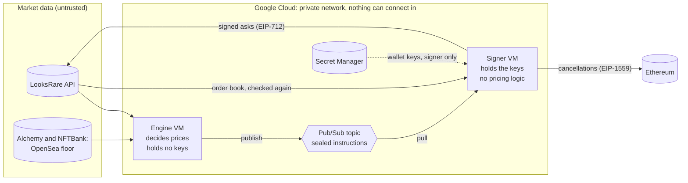

<p align="center">
  <picture>
    <source media="(prefers-color-scheme: dark)" srcset="docs/assets/banner-dark.svg">
    
  </picture>
</p>

# Autolister

Autolister keeps our investors' NFT positions listed on LooksRare at prices that
earn listing rewards without getting them sold below value. Every minute it
reprices each position against the floor across LooksRare and OpenSea. The
orders are signed on a separate machine, the only place the wallet keys exist,
behind a price check the pricing code cannot get around.

| | |
|---|---|
| **Owner** | Kristine Vik Andresen |
| **Runs on** | Google Cloud: Compute Engine, Pub/Sub, Secret Manager, Cloud Logging and Monitoring |
| **On call** | Alerts go to the on-call address, and each one links to its entry in the [runbook](docs/runbook.md) |
| **Stack** | Python 3.10, web3.py 5, pydantic, Terraform 1.3 |

## How it works



1. **The engine observes.** Once a minute it reads the 200 cheapest asks on
   LooksRare and the OpenSea floor from two independent providers.
2. **It decides.** For each investor account it compares the live listing with
   the [pricing rules](docs/strategy.md) and decides to hold, list, lower, or
   cancel and relist.
3. **It asks the signer.** Each decision becomes an *instruction*: "list
   account A at price P until T", or "cancel everything for account A". The
   engine seals it with an HMAC and publishes it to a Pub/Sub topic, ordered
   per account.
4. **The signer checks.** It verifies the seal and the instruction's age, drops
   duplicates and stale instructions, and recomputes the emergency stop from its
   own read of the order book.
5. **The signer acts.** It signs EIP-712 asks for the tokens the wallet still
   holds, or sends one on-chain transaction that cancels every open order.

The engine is a control loop: each cycle it compares what *is* on the order
book with what *should* be, and acts on the difference. A lost or failed
instruction is therefore corrected by a later cycle, which keeps the signer
simple. [docs/architecture.md](docs/architecture.md) walks through the details.

## What must always be true

These are the system's invariants. Each is enforced in code or in
infrastructure, often both, and every one enforced in code has a test.

| Invariant | How |
|---|---|
| **Wallet keys exist only on the signer** | Per-secret IAM in Secret Manager; the engine's image does not even contain a signing library, and a test keeps it that way |
| **Nothing is listed below the emergency floor** (the 21st cheapest ask) | One rule in [`autolister_core.guard`](libs/core/src/autolister_core/guard.py), evaluated independently by both services |
| **The signer acts only on authentic, fresh, new instructions** | HMAC seal, a one-hour expiry, per-account ordering and a replay guard |
| **The signer can list and cancel, and nothing else** | No code path transfers tokens, approves spenders or sends ETH, and a test keeps it that way |
| **Nothing can connect in** | No public IPs, a deny-all ingress rule, no SSH |
| **We can stop it quickly** | Two kill switches and a break-glass "cancel everything" ([runbook](docs/runbook.md)) |

The reasoning behind these, and what they do not protect against, is in the
[threat model](docs/threat-model.md).

## Repository layout

```
libs/core/src/autolister_core/        what both services share
  instructions.py                     the sealed instruction protocol
  guard.py                            the emergency stop
  accounts.py                         the accounts file schema
  money.py                            integer wei, and exact percentages
services/engine/src/autolister_engine/  decides prices; holds no keys
  domain/pricing.py                   the pricing rules: pure functions
  engine.py                           the control loop
  breakglass.py                       cancel everything, now
  adapters/                           LooksRare, floor providers, Pub/Sub, state
services/signer/src/autolister_signer/  signs orders; the only service with keys
  signer.py                           verify, check, sign, submit, acknowledge
  eip712.py                           LooksRare maker orders, byte for byte
  replay.py                           replay protection
  adapters/                           Pub/Sub, LooksRare, Ethereum, Secret Manager
config/
  strategy.yaml                       pricing parameters, reviewed like code
  accounts.yaml                       wallets under management (addresses only)
infra/terraform/                      every cloud resource, with least privilege
docs/                                 architecture, strategy, threat model, runbook, ADRs
```

Each service follows the same shape: domain logic depends only on *ports*
(interfaces in `ports.py`), and *adapters* implement them against the outside
world. The tests swap in fakes, so nearly everything is tested without a
network.

## Development

You need Python 3.10 and `make`.

```bash
make install    # .venv with the locked toolchain and every package, editable
make check      # format check, lint, strict type check and every test suite
make fmt        # black and isort
make hooks      # run the fast checks (including a secret scan) on every commit
```

`make help` lists everything else. To work on one package, run `pytest` from its
directory. Property-based tests run 100 examples each locally and 1,000 in CI
(`HYPOTHESIS_PROFILE=ci`).

Dependencies are pinned with hashes in each service's `requirements.txt`. To
add or change one, edit the `requirements.in` next to it and run `make lock`.
Shared dependencies follow the signer's pins, so one environment can test both
services against the exact versions they run in production.

## Testing

| Layer | What it proves |
|---|---|
| Pricing rules | Unit tests for every rule, plus property tests: no proposal ever undercuts the emergency floor, a held listing is always safe and earning, and a renewal never raises the price |
| Services | End-to-end scenarios against in-memory fakes of every port: cancel-and-relist, the kill switches, sale cooldowns, replays, partial failures, one account failing while another carries on |
| Signing | A known-answer test pins the exact EIP-712 digest; the signature is verified against it with a separate library |
| Architecture | The engine cannot sign: neither its code nor its image contains a signing library. The only contract function the signer can call that changes anything is the cancellation |
| Adapters | Contract tests against recorded API responses, and a fake Ethereum JSON-RPC node that drives the real web3 stack |
| Infrastructure | `terraform fmt` and `terraform validate` in CI |

What the tests cannot cover is the live market. Strategy changes therefore ship
with trading disabled first, so the engine logs its decisions without acting on
them ([runbook](docs/runbook.md#change-the-strategy)).

## Configuration

| Where | What | Changed by |
|---|---|---|
| [`config/strategy.yaml`](config/strategy.yaml) | Pricing parameters | Pull request, then deploy |
| [`config/accounts.yaml`](config/accounts.yaml) | Wallets and the tokens in each | Pull request, then deploy ([adding an account](docs/runbook.md#add-an-account)) |
| `AUTOLISTER_*` environment variables | Deployment settings and the kill switches | Terraform variables |
| Secret Manager | Wallet keys, the HMAC key, API keys, the RPC URL | An operator, with `gcloud`; never Terraform, never git |

Both files in `config/` ship inside the images, so a deployed version always
runs with the configuration it was reviewed with, and a rollback restores both.
Everything is validated at start-up: a bad value stops the service before it
can trade.

## Deployment

CI ([`.github/workflows/ci.yml`](.github/workflows/ci.yml)) checks every pull
request and builds both images; on `main` it also pushes them, tagged with the
commit SHA. CI authenticates through Workload Identity Federation, so no
service account key exists anywhere.

Deploying is a Terraform apply, run from the commit being deployed:

```bash
terraform -chdir=infra/terraform apply -var image_tag=<commit SHA>
```

Each service runs in a managed instance group of one VM. A new image tag
replaces the VM, stopping the old one before the new one starts, so there is
never more than one signer. Rolling back is the same command with the previous
SHA. First-time setup is covered in the
[runbook](docs/runbook.md#first-time-setup).

## Design decisions

The reasoning behind the main choices is recorded as
[architecture decision records](docs/adr/):

1. [Record architecture decisions](docs/adr/0001-record-architecture-decisions.md)
2. [Keep the keys in a separate signer](docs/adr/0002-keep-the-keys-in-a-separate-signer.md)
3. [Send sealed instructions over Pub/Sub](docs/adr/0003-send-sealed-instructions-over-pubsub.md)
4. [One emergency stop, enforced twice](docs/adr/0004-one-emergency-stop-enforced-twice.md)
5. [Reconcile against the order book](docs/adr/0005-reconcile-against-the-order-book.md)
6. [Run containers on VMs, not Kubernetes](docs/adr/0006-run-containers-on-vms.md)
7. [Represent money as integer wei](docs/adr/0007-represent-money-as-integer-wei.md)
8. [Ship configuration with the code](docs/adr/0008-ship-configuration-with-the-code.md)
