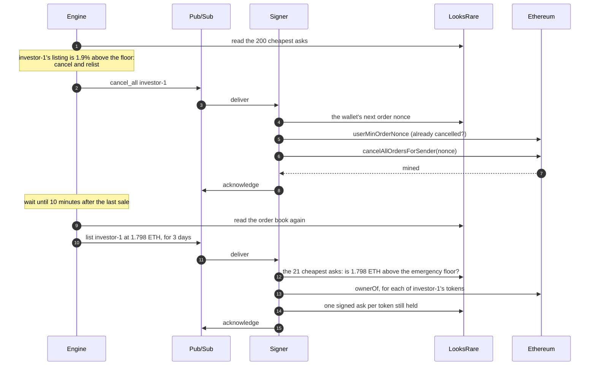

# Architecture

Autolister is two services and a shared library, deployed on Google Cloud:

| | Engine | Signer |
|---|---|---|
| **Job** | Watch the market and decide prices | Verify, check again, sign and submit |
| **Reads** | LooksRare order book, OpenSea floor | Instructions, the public order book, token ownership |
| **Writes** | Instructions | Signed asks (LooksRare API), cancellations (Ethereum) |
| **Wallet keys** | Never; its image has no signing library | From Secret Manager, when needed, never cached |
| **Pricing logic** | All of it | None, apart from the emergency stop |
| **Runs** | A loop, once a minute | A loop, pulling instructions as they arrive |

`autolister_core` holds what the two must agree on: the instruction protocol,
the emergency stop, the accounts schema, and how money is represented.

## The engine's cycle

Once a minute, the engine:

1. **Checks the rewards gate.** If the collection has dropped out of LooksRare's
   top five listing-rewards collections, there is nothing to earn, so it logs
   `paused` and waits for the next cycle.
2. **Observes.** It reads the 200 cheapest valid asks at or above 0.1 ETH
   (cheaper ones are troll listings), and the OpenSea floor from Alchemy and
   NFTBank, using whichever reading is fresher. The LooksRare floor is the
   cheapest ask; the *global* floor is the lower of the two.
3. **Manages each account on its own thread.** Accounts are independent, and
   handling one can mean waiting a few minutes, so one slow account never holds
   up another. For each account it:
   - finds the account's live listing *in the order book itself*, not in its
     own records, and
   - applies the [pricing rules](strategy.md), which decide one of: hold
     (renewing if the listing is about to expire), list, lower, or cancel and
     relist.
4. **Publishes instructions** for whatever needs doing, unless trading is
   disabled, in which case it logs the decision and stops there.

Because the engine always starts from what the order book shows, it does not
need to know whether its previous instructions succeeded. If one was lost or
rejected, the next cycle sees the market as it is and asks again. See
[ADR 0005](adr/0005-reconcile-against-the-order-book.md).

## The instruction protocol

An instruction is the only thing the engine can send the signer. It says
*what* to do. The signer alone decides *how*, from its own configuration: the
collection, the currency, the order type, and the minimum share the seller must
receive are not up to the engine.

| Field | Meaning |
|---|---|
| `action` | `list` or `cancel_all` |
| `account_id` | Which wallet, from `config/accounts.yaml` |
| `issued_at` | When the engine issued it (Unix time) |
| `instruction_id` | A random id, unique per instruction |
| `price_wei` | `list` only: the price, in wei |
| `end_time` | `list` only: when the asks expire |

On the wire, each instruction is *sealed*: an HMAC-SHA256 over a canonical JSON
encoding, under a key that only the two services (and on-call, for the
break-glass command) can read.

```json
{
  "payload": {
    "action": "list",
    "account_id": "investor-1",
    "issued_at": 1666000000.0,
    "instruction_id": "9b2c7e4f0a6d4c1e8f3b5a7d2e1c0f9a",
    "price_wei": 1712000000000000000,
    "end_time": 1666259200,
    "v": 1
  },
  "mac": "<HMAC-SHA256 of the canonical payload, hex>"
}
```

Pub/Sub IAM already limits who can publish. The seal means the signer does not
depend on that one setting staying correct. See
[ADR 0003](adr/0003-send-sealed-instructions-over-pubsub.md).

Each account's instructions share a Pub/Sub *ordering key*, so the signer
receives them in the order they were issued, while accounts never block each
other.

## The signer's loop

The signer pulls up to 100 instructions at a time, then:

1. **Verifies each one.** It must carry a valid seal, be less than an hour old,
   name a known account, and be *new*: not handled before, and not issued
   before something the signer has already done for that account. Anything else
   is acknowledged and dropped, because retrying cannot make it valid.
2. **Plans each account's batch.** In issue order, a newer listing supersedes
   an older one, and a cancellation discards any listing issued before it. So
   `list A, cancel, list B` becomes "cancel, then list B".
3. **Cancels**, if the plan says so: one transaction,
   `cancelAllOrdersForSender(nonce)`, invalidates every open order for the
   wallet. Cancelling is idempotent: if the chain shows it has already been done,
   nothing is sent.
4. **Lists**, if the plan says so:
   - It reads the 21 cheapest asks itself and refuses anything below the
     emergency floor ([ADR 0004](adr/0004-one-emergency-stop-enforced-twice.md)).
   - It asks the chain which of the account's tokens the wallet still holds.
   - It signs one EIP-712 ask per token, with consecutive order nonces, and
     submits them a second apart.
5. **Acknowledges** the batch, or hands it back to Pub/Sub if anything failed.

## Delivery guarantees

Pub/Sub delivers at least once, so the design has to say what happens to a
message in every case:

| Case | What happens |
|---|---|
| Invalid, expired, unknown account, or already handled | Acknowledged and dropped, with a log event (`rejected`, `expired` or `duplicate`) |
| Refused by the emergency stop | Acknowledged: refusing *is* handling it. Logged as `emergency_stop`, which alerts |
| Fails before any order reaches the exchange (an API or RPC error) | Handed back and redelivered, with a 10 s to 5 min backoff. After five attempts it moves to the dead-letter topic, which alerts |
| A cancellation is mined, then the listing after it fails | The cancellation is recorded as done before the batch is handed back, so the retry only lists |
| An order is submitted | At most once. An order rejected by the exchange, or whose fate is unknown, is logged and not retried, because a retry could list the token twice. The engine's next cycles notice anything missing |

## A cancel and relist, end to end



## State

Both services keep a little state on their VM's disk. Neither depends on it for
safety, and both are designed to lose it, because replacing a VM (every deploy)
does exactly that.

| Service | What | If it is lost |
|---|---|---|
| Engine | The previous floor, to detect sharp drops | The first cycle after a restart cannot detect a sharp drop |
| Engine | Listings priced deeper than the 200 asks it reads | The engine relists those positions; the cheaper ask fills first, so the old one is harmless |
| Signer | Replay marks: the newest instruction handled per account | Pub/Sub never redelivers what was acknowledged, and instructions expire after an hour, so the exposure is a duplicate delivery that arrives during a restart. A duplicate cancellation is a no-op; a duplicate listing creates a second, identical ask |

## Failure modes

| Failure | Effect | Recovery |
|---|---|---|
| LooksRare API down | Reads are retried four times with backoff. Then the engine's cycle fails (`error` alerts) and nothing is published; the signer hands instructions back | Automatic when the API recovers |
| One floor provider down | The other one is used | Automatic |
| Both floor providers down | The engine prices against the LooksRare floor alone. That can only make prices *higher*, never lower | Automatic |
| Ethereum RPC down | Cancellations and ownership checks fail and are redelivered, then dead-lettered | Automatic, or see the runbook for dead letters |
| Gas spike above the fee cap | A cancellation waits unmined; after five minutes the instruction is redelivered, and later dead-lettered | Raise `max_fee_gwei` ([runbook](runbook.md#dead-lettered-instruction)) |
| Pub/Sub unavailable | The engine cannot publish (`error` alerts); it asks again next cycle | Automatic |
| Signer VM dies, even mid-cancellation | The group recreates it. Unacknowledged instructions are redelivered, and a cancellation that was mined is not sent again | Automatic |
| Engine VM dies | The group recreates it, and the engine rebuilds its view from the order book | Automatic |
| The engine is compromised | It can publish any instruction it likes. The signer still refuses prices below the emergency floor, and cannot transfer anything | See the [threat model](threat-model.md) |

## Infrastructure

Everything is in [`infra/terraform`](../infra/terraform). In short:

- **Compute.** Each service is one container on a Container-Optimized OS VM, in
  a managed instance group of one, with shielded boot. Containers run as an
  unprivileged user, on a read-only filesystem, with every Linux capability
  dropped.
- **Network.** A private VPC: no public IPs, a deny-all ingress rule, and no
  SSH. Outbound traffic goes through Cloud NAT; Google APIs are reached
  privately.
- **Identity.** A service account per workload. The engine can publish to the
  topic and read three secrets; the signer can consume the subscription and read
  the wallet keys. Each secret has its own access list.
- **Messaging.** One topic, one ordered subscription (600 s acknowledgement
  deadline, 1 h retention), and a dead-letter topic that keeps failed
  instructions for a week.
- **Delivery.** CI pushes images to Artifact Registry through Workload Identity
  Federation, so no long-lived key exists. A deploy is a Terraform apply with a
  new image tag.
- **Observability.** Both services write one JSON object per log line, each
  with an `event` field. Log-based metrics and Pub/Sub metrics drive the
  alerts, and each alert links to the [runbook](runbook.md).

### Log events

| Event | Service | Meaning | Alerts |
|---|---|---|---|
| `start` | Both | The service started, with its kill switch setting | |
| `market` | Engine | A cycle observed the market (floors, depth) | Its absence does |
| `paused` | Engine | The collection is outside the rewards window | Its absence does, with `market` |
| `decision` | Engine | The decision for one account, with the reason | |
| `list` | Engine | Published a listing instruction | |
| `hold` | Engine | No safe lower price; keeping the current one | |
| `provider_error` | Engine | A floor provider failed; the other was used | |
| `manual_cancel` | Engine | The break-glass command published a cancellation | |
| `kill_switch` | Both | Trading or signing is disabled | |
| `emergency_stop` | Both | A listing was refused by the emergency stop | Yes |
| `rejected` | Signer | An instruction failed verification, or its content was invalid | Yes |
| `expired` | Signer | An authentic instruction was too old (expected after a pause) | |
| `duplicate` | Signer | An instruction was already handled or superseded | |
| `cancelled` | Signer | Every order below a nonce is invalid on chain | |
| `listed` | Signer | Asks submitted, with any the exchange rejected | |
| `nothing_to_list` | Signer | The wallet holds none of its tokens | |
| `error` | Both | Anything unexpected | Yes |
