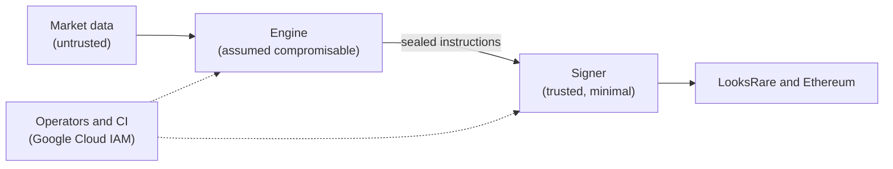

# Threat model

This document says what Autolister protects, what it assumes, how it can be
attacked or fail, and which risks we have chosen to accept. Review it whenever
the architecture changes, and at least once a quarter.

## What we protect

| Asset | Why it matters |
|---|---|
| **Wallet private keys** | Whoever holds a key controls every NFT and every token in that wallet |
| **The investors' NFTs** | They are the capital. Selling one below its value is a realised loss |
| **The instruction HMAC key** | Whoever holds it can write instructions the signer accepts |
| **API keys and the RPC URL** | Abuse costs money and rate limits; the LooksRare key submits orders (which must still be signed) |
| **Configuration** | `strategy.yaml` decides prices; `accounts.yaml` decides which tokens are traded |

## The design assumption

**The component that parses untrusted data all day is the one most likely to be
compromised, so it must not be able to move assets.**

The engine reads market data that anyone can influence: listings on LooksRare
are written by whoever wants to write them, and our data providers can be wrong.
So we design as if the engine may be compromised, and it holds no keys. The
signer holds the keys, so it is kept small, checks everything it is asked to do,
and is able to do very little. See
[ADR 0002](adr/0002-keep-the-keys-in-a-separate-signer.md).

## Trust boundaries

## Threats and mitigations

| # | Threat | Mitigations | What is left |
|---|---|---|---|
| 1 | **Manipulated market data**: a wrong floor from a provider, troll asks, wash listings | Asks under 0.1 ETH are ignored. The global floor is the *lower* of two sources, so a wrong high reading has no effect. The emergency floor comes from the public order book and is checked again by the signer, so a wrong low reading is refused rather than listed | Moving the emergency floor takes 20 real asks that anyone can buy: expensive to do on purpose |
| 2 | **The engine is compromised**, through a dependency, a parsing bug or its credentials | The engine holds no keys and has no signing code. The signer fixes the collection, currency, order type and minimum seller share itself, rejects expiries beyond 30 days, recomputes the emergency floor, and can do nothing but list and cancel | An attacker can cancel every listing (costing gas and rewards) or list every token *at* the emergency floor: a sale at roughly the 21st cheapest price in the collection. Both are visible in the logs |
| 3 | **Forged instructions**, if topic permissions are ever misconfigured | Every instruction is sealed with an HMAC; a bad seal is rejected and alerts | None, unless the HMAC key also leaks (see 6) |
| 4 | **Replayed instructions** | Instructions expire after an hour; the signer refuses anything it has handled before, or anything issued before something it has already done | Replay marks live on the signer's VM and reset when it is replaced, so a replay inside the hour after a deploy would be accepted. It still needs the attacker to publish to the topic |
| 5 | **The signer is compromised** | Nothing can connect in. Minimal code; hash-pinned dependencies; a hardened container (unprivileged, read-only, no capabilities) on a shielded VM. Keys are fetched when used and never written to disk or logs. Every read of a wallet key is audit-logged, and a read by anyone but the signer alerts | **The main residual risk.** Firewall rules filter by IP address, not by hostname, and the APIs the signer calls sit behind CDNs, so outbound traffic is not restricted. A compromised signer could send keys out. The response is in the [runbook](runbook.md#a-wallet-key-may-be-exposed) |
| 6 | **Secrets leak** through the repository, CI or Terraform state | Secret values never enter git (a secret scan runs on every commit) or Terraform (values are added with `gcloud`). CI has no keys: it authenticates through Workload Identity Federation, and only `main` can push images | A person with access to a secret can still mishandle it |
| 7 | **A malicious dependency update** | Every dependency is pinned by hash and changes only through a reviewed `make lock` pull request. The engine's image has no signing library at all, and a test keeps it that way | The signer depends on web3.py, which has a large dependency tree. Review signer lock changes with extra care |
| 8 | **A bad change**, malicious or mistaken | Pull request review and CI. Strategy changes ship in shadow mode first. The emergency stop backs everything | A change to the signer itself can weaken its checks. Signer changes need a second reviewer |
| 9 | **An operator account is compromised** | Operators can read the HMAC key and publish, for break-glass use, but not wallet keys; that is equivalent to threat 2. Every secret access is audit-logged | Project owners can grant themselves anything. Keep that group small, with hardware security keys |
| 10 | **A cancellation is front-run**: an order fills while its cancellation is pending | None needed for safety: anything that fills does so at a price we signed, which was above the emergency floor at the time | Accepted |
| 11 | **The system is down during a rally** and listings that are now too cheap fill | Alerts on a silent engine and on stuck instructions; a break-glass command cancels every listing at once | Detection and response take minutes |

## Things the system deliberately cannot do

- Transfer a token, approve a spender, or send ETH. There is no code for it, and
  a test fails the build if the signer gains a second contract function that
  writes.
- Sign for a collection, currency or order type other than the ones in its own
  settings.
- Grant itself approval to trade. Each wallet approves LooksRare's transfer
  manager for the collection once, by hand, outside this system.

## Residual risks we accept

1. **Unfiltered egress from the signer** (threat 5). Mitigated by keeping the
   signer small and pinned, and by detection. A response plan exists.
2. **A compromised engine can force sales at the emergency floor** (threat 2).
   That loss is bounded and visible, and it is the price of an automated system.
3. **Replay marks reset on deploy** (threat 4). Exploiting it needs publish
   access to the topic within an hour of a deploy. A durable store would close
   it; so far the complexity is not worth it.
